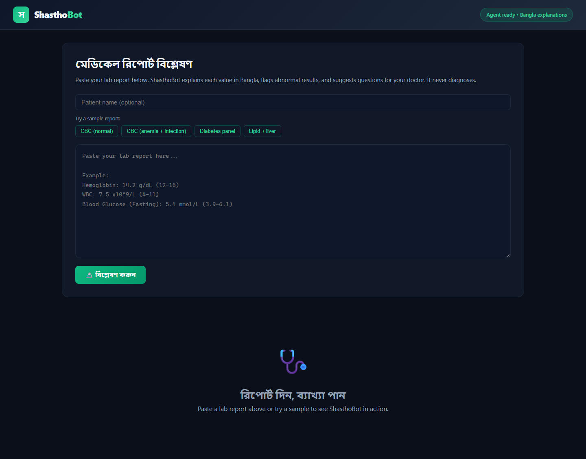
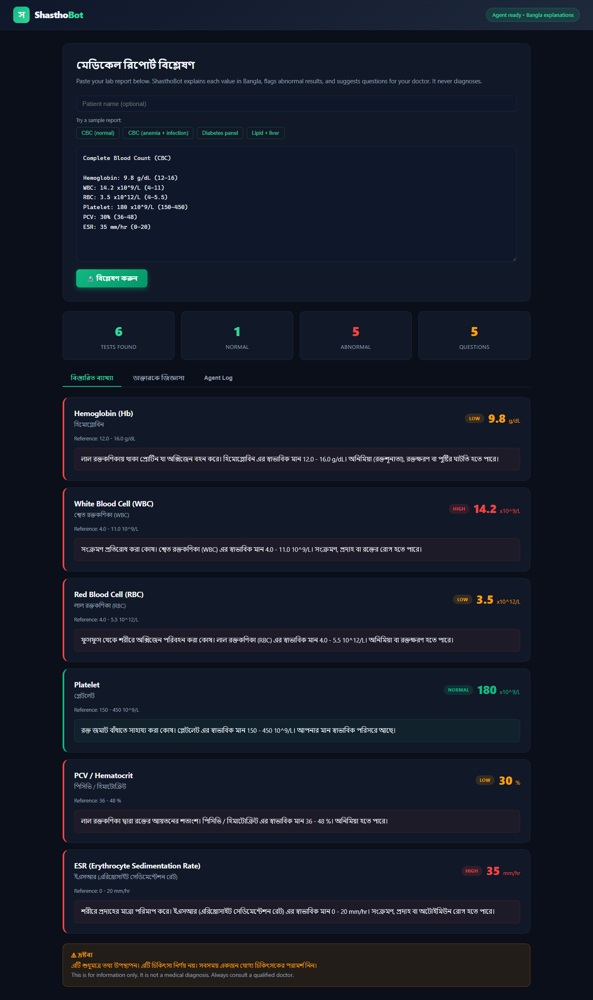
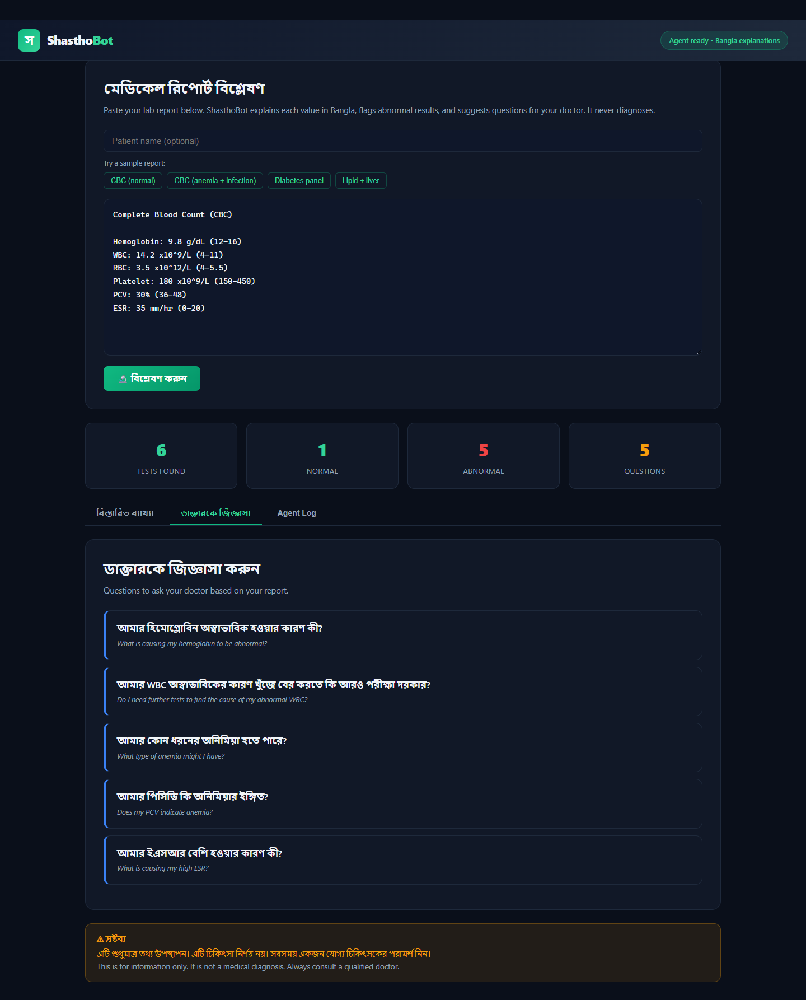
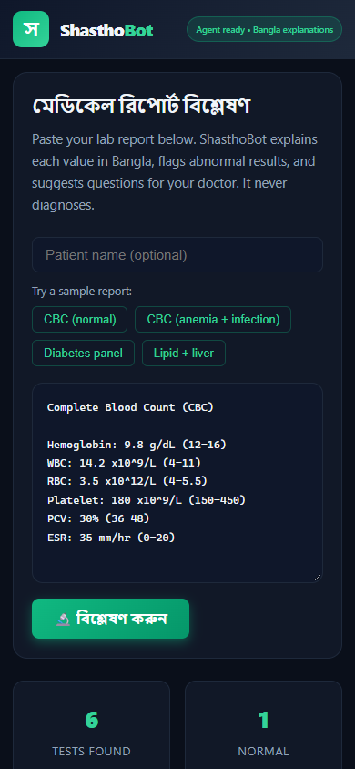

# ShasthoBot — Medical Report Explainer

An AI-powered lab report explainer for Bangladeshi patients. Paste your blood test results and ShasthoBot explains each value in **Bangla**, flags abnormal results, and suggests questions to ask your doctor. It **never diagnoses** — it explains, you and your doctor decide.

## Problem

Lab reports in Bangladesh are dense, English-jargon-heavy, and rarely explained. Patients leave the diagnostic center with numbers they don't understand and never ask their doctor the right questions. ShasthoBot closes that gap in plain Bangla.

## How it works

ShasthoBot runs a **bounded agent loop** over a curated knowledge base of 14 common lab tests (CBC, diabetes, lipids, liver, kidney, uric acid):

| Step | Tool | What it does |
|------|------|--------------|
| 1 | `parse_report` | Extracts test name, value, unit, reference range from free text |
| 2 | `explain_values` | Explains each test and flags status (normal / high / low) in Bangla |
| 3 | `flag_abnormal` | Highlights out-of-range values with severity and action |
| 4 | `suggest_questions` | Generates Bangla + English questions for your doctor |

The engine is deterministic and runs fully offline — no report data ever leaves your machine.

## Features

- **16 clinical markers** covered: hemoglobin, WBC, RBC, platelets, PCV, ESR, fasting glucose, HbA1c, cholesterol, triglycerides, creatinine, uric acid, SGOT/AST, SGPT/ALT
- **Bangla + English** explanations and doctor questions
- **Red / amber / green** status coding on every result
- **Built-in samples** to try instantly (CBC, anemia panel, diabetes panel, lipid + liver)
- **Privacy-first**: SQLite local storage, no cloud, no account

## Screenshots

| Input | Results |
|-------|---------|
|  |  |

| Doctor questions | Mobile |
|-----------------|--------|
|  |  |

## Usage Guide

### 1. Analyze a report
1. Open the app → the input screen shows a text area.
2. **Option A** — click a sample button (`CBC (anemia + infection)`) to load a realistic report.
3. **Option B** — paste your own lab report as plain text, one test per line, e.g.:
   ```
   Hemoglobin: 9.8 g/dL (12-16)
   WBC: 14.2 x10^9/L (4-11)
   Blood Glucose (Fasting): 8.9 mmol/L (3.9-6.1)
   ```
4. (Optional) enter a patient name.
5. Click **বিশ্লেষণ করুন** (Analyze).

### 2. Read the results
- **Test found / Normal / Abnormal / Questions** stats at a glance
- Each result card shows the value, unit, reference range, status badge, and a **Bangla explanation** of what it means and why it matters
- Red cards = abnormal → consult your doctor

### 3. Ask your doctor
Open the **ডাক্তারকে জিজ্ঞাসা** tab → a list of Bangla + English questions generated from your abnormal values. Show it to your doctor.

### 4. Agent Log
The **Agent Log** tab shows the exact tool calls the agent made — full transparency, nothing hidden.

### 5. Disclaimer
ShasthoBot is informational only and is **not** medical advice or diagnosis. Always consult a qualified physician.

## Local Run

### Prerequisites
- Python 3.11+
- Node 18+

### Backend
```powershell
cd backend
python -m venv .venv
.\.venv\Scripts\python.exe -m pip install fastapi uvicorn pydantic
.\.venv\Scripts\python.exe -m uvicorn app.main:app --host 127.0.0.1 --port 8837
```

### Frontend
```powershell
cd frontend
npm install
npm run build
```

The backend serves the built frontend at **http://127.0.0.1:8837/**.

### Development Mode
```powershell
cd frontend
npm run dev
```
Proxies `/api` to `http://127.0.0.1:8837`.

## API

| Endpoint | Method | Description |
|----------|--------|-------------|
| `/api/health` | GET | Health check |
| `/api/analyze` | POST | Run the agent on report text |
| `/api/investigations` | GET | List past analyses |
| `/api/investigations/{id}` | GET | Full analysis detail |

## Tech Stack

- **Backend:** Python 3.14, FastAPI, SQLite
- **Frontend:** React 18, TypeScript, Vite
- **Agent:** Deterministic 4-tool loop over a curated clinical knowledge base
- **Languages:** Bangla + English

## Honest Boundaries

- Not a diagnosis. Never a substitute for medical advice.
- Text input today (no image OCR yet) — paste the report as text.
- Reference ranges vary by lab and sex; ShasthoBot uses standard adult ranges and says so.
- Coverage limited to 14 common tests; others are reported as "unknown", never guessed.
- No data leaves your machine.
